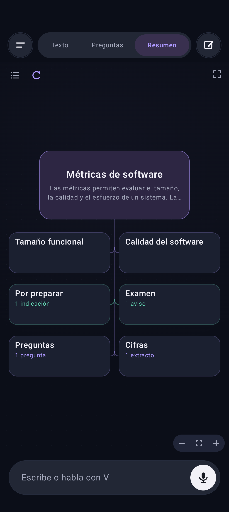
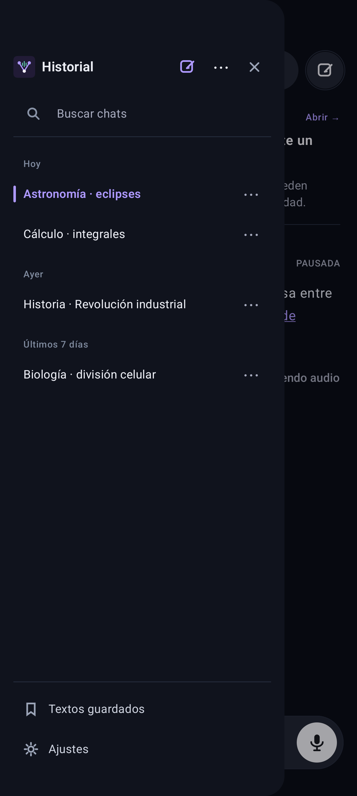

# V · Voice Assistant Android


Asistente para estudiantes en Kotlin y Jetpack Compose: transcripción, respuestas online sin registro ni clave, contexto de clase, carpetas, tareas, avisos de examen, historial en el dispositivo y escucha en segundo plano con botón flotante.

## Interfaz actual · 0.30

Texto, Preguntas y Resumen permanecen arriba. Texto muestra la transcripción y copia directa; Preguntas conserva respuestas desplegables. Resumen usa el espacio central como un lienzo con síntesis, apuntes y acceso a sus fuentes. Las carpetas desplegables agrupan las conversaciones elegidas por el usuario.

Captura con contenido ficticio:



## Android 0.30: mapas ampliados por IA y GPT con Puter

**Resumen → Ampliar y organizar mapa** genera un material de estudio con tema central, entre cinco y diez ramas solicitadas, subtítulos y explicaciones breves. Cada rama muestra sus conceptos directamente en el lienzo; puedes moverlo, ampliar la vista y abrir los detalles. El mapa se conserva dentro de su conversación y se incluye completo al copiar o guardar.

La ampliación usa el proveedor de IA seleccionado. **La app no consulta Wikipedia ni recupera artículos.** Reutiliza el análisis anterior del chat y realiza una solicitud agrupada para elaborar el mapa; no consulta cada frase ni cada concepto por separado. El análisis periódico de preguntas y apuntes sigue siendo una etapa independiente. Las explicaciones nuevas se identifican como **IA**; los puntos atribuidos a la grabación requieren evidencia literal y conservan el enlace a su texto original. La IA puede equivocarse y esta ampliación no equivale a verificación externa de los hechos.

| Proveedor | Uso en V | Conexión y límites |
| --- | --- | --- |
| Pollinations Classic | Opción inicial; preguntas, organización y mapas mediante el transporte ya existente. | Sin registro ni clave; conserva una solicitud a la vez y la espera entre solicitudes del servicio gratuito. |
| Puter · GPT-5.6 Luna | Opción elegida explícitamente en Ajustes; usa las mismas instrucciones y el contexto del chat. | **Ajustes → Respuestas online → GPT · Puter → Conectar Puter**. No pide una clave de API. Requiere conectar una sesión de Puter; el SDK admite acceso temporal cuando esté disponible. |

Puter ofrece una asignación gratuita con límites, y [el consumo corresponde a la cuenta del usuario](https://docs.puter.com/user-pays-model/). No se promete acceso ilimitado. V no compra saldo ni amplía planes automáticamente. Los límites o errores conservan los apuntes anteriores y no cambian de proveedor automáticamente. La disponibilidad del modelo se comprueba con el catálogo de la sesión; no se sustituye por otro modelo silenciosamente.

La interfaz principal permanece nativa en Kotlin y Compose. Solo la conexión y las llamadas del SDK de Puter utilizan un WebView aislado con un origen local en el teléfono, según los [orígenes admitidos por Puter](https://docs.puter.com/supported-platforms/). No requiere un servidor en el Mac ni publicar una web. El SDK gestiona su sesión en el almacenamiento privado del WebView: el token no se copia a la base de conversaciones. El componente no dispone de acceso a archivos, cámara o micrófono. Las solicitudes HTTPS siguen activas para los servicios externos; HTTP se permite únicamente para el origen local.

La app envía las preguntas y los fragmentos necesarios al proveedor elegido, sin enviar audio ni la biblioteca de textos guardados. La conexión a Puter se inicia con una acción del usuario. No se incluyen herramientas de búsqueda web en sus llamadas de IA.

Compilación e instalación en emulador correctas: **68 pruebas unitarias y 25 instrumentadas correctas**. Las respuestas de IA se comprobaron con un transporte de prueba. Además, se verificó la carga real del SDK oficial de Puter sin iniciar sesión, crear cuentas ni consumir créditos. La generación real con GPT queda pendiente de conectar la sesión del usuario; esto no es una medición de precisión del modelo ni una prueba en teléfono físico.

[Ejemplo visual del mapa con contenido de prueba](docs/assets/v-model-eclipse-map-synthetic.png) · [Verificación](docs/model-map-verification.json).

## Android 0.28: resumen con contexto y estructura

Al tocar el tema central de **Resumen** se abre un documento de lectura con título breve, síntesis global y subtítulos específicos. Los apuntes aparecen juntos y se desplazan sobre casi toda la pantalla; los iconos junto a cada subtítulo abren sus fuentes. **Copiar** y **Guardar resumen** incluyen el título, la síntesis y todas las secciones, también las que no caben como ramas en el lienzo. Se conserva la paleta de V.

| Parte | Comportamiento |
| --- | --- |
| Título | Describe el asunto establecido. Empieza como **Desconocido** cuando el contenido aún no basta. Puede ampliar el tema del resumen sin sobrescribir el nombre elegido para el chat. |
| Síntesis | Se solicita una visión global de 3 a 5 frases, relacionando las ideas centrales con el contexto anterior. |
| Subtítulos | Nombran contenidos concretos, como **Tamaño funcional**, **Factores del esfuerzo** o **Entrevistas de auditoría**; se descartan encabezados genéricos como «Tema 1» o «Desarrollo». |
| Actualización | El análisis recibe secciones previas completas que caben en su contexto. Puede consolidarlas, renombrarlas o unirlas mediante referencias validadas. Las secciones no actualizadas se conservan. |
| Fuentes | Se distinguen los IDs del bloque nuevo de las referencias a notas anteriores. Una fuente corregida no vuelve a utilizarse como contexto válido con su revisión antigua. |
| Lienzo | Aprovecha hasta seis ramas de apuntes cuando no hay tareas, avisos de examen o preguntas que necesiten una rama. Todo el contenido sigue accesible en el documento completo. |

La app conserva el servicio online y su espera entre solicitudes; esta mejora no añade llamadas paralelas ni solicitudes extra para titular. El texto original permanece disponible. La síntesis se basa en lo transcrito: **no realiza investigación web ni verifica externamente los hechos**. La validación de referencias comprueba la procedencia, no garantiza por sí sola que cada interpretación del modelo sea correcta.

Se corrigió la acumulación indiscriminada de párrafos: una consolidación explícita reemplaza la nota anterior y conserva sus fuentes. Si una respuesta antigua o incompleta omite la referencia necesaria, se conservan los apuntes previos para evitar pérdidas. Tampoco se eliminan temas antiguos al superar veinte secciones.

Referencia de diseño: [SummN, ACL 2022](https://aclanthology.org/2022.acl-long.112/), que estudia la organización de resúmenes largos por etapas. Las comprobaciones de esta versión validan el funcionamiento y la conservación del contenido; no constituyen una medición académica de precisión del modelo.

### Burbuja al borde

La burbuja es circular, mantiene su icono visible de 32 dp y se ajusta al borde más cercano al soltarla: izquierda, derecha, arriba o abajo, respetando las barras del sistema. El mensaje queda a 2 dp del círculo, dura **cuatro segundos** y se descarta deslizando en cualquier dirección. Se retiró la ×; también existe una acción de descarte para accesibilidad. Tocar el mensaje abre su respuesta y mantiene la escucha.

Compilación e instalación correctas en el emulador: **66 pruebas unitarias y 24 instrumentadas correctas**, con contenido ficticio y respuestas de prueba, sin solicitudes reales al modelo. La escucha en segundo plano se comprobó en una ejecución instrumentada independiente. Capturas revisadas; prueba en teléfono físico pendiente.

[Resumen organizado](docs/assets/v-organized-summary-synthetic.png) · [Burbuja circular](docs/assets/v-edge-floating-question-synthetic.png) · [Verificación](docs/organized-summary-verification.json).

## Android 0.27: burbuja discreta y preguntas como mensajes

**Ajustes → Escucha en segundo plano → Botón flotante** muestra el logo de V más pequeño y semitransparente al salir de la app mientras escuchas. Arrástralo para moverlo; al tocarlo aparecen los controles de volver y detener. El permiso de mostrar sobre otras aplicaciones sigue siendo opcional y se solicita mediante Android.

Una pregunta del audio con respuesta terminada aparece al lado como un mensaje breve: hasta dos líneas de pregunta y dos de respuesta. Tócalo para abrir esa respuesta concreta o usa × para ocultarlo. Cada mensaje dura diez segundos; si llegan varios, esperan su turno sin sustituir de golpe el anterior. Hay hasta ocho mensajes pendientes; todas las respuestas permanecen en Preguntas aunque su vista flotante no se muestre. Tocar la burbuja permite volver a consultar la última. Las preguntas ya vistas dentro del chat no se vuelven a anunciar al salir. Las sugerencias de repaso, respuestas a consultas escritas, fragmentos incoherentes y generaciones incompletas no producen avisos automáticos.

| Elemento | Presentación |
| --- | --- |
| Logo visible | 32 dp, con área de toque de 48 dp. |
| Burbuja en reposo | 38 % de opacidad. |
| Mensaje automático | 58 % de opacidad, ancho máximo de 224 dp. |
| Controles abiertos | 80 % de opacidad para facilitar su lectura. |
| Avisos | Sin sonidos ni vibraciones añadidos. |

Las dos ventanas ocupan únicamente la burbuja y el mensaje; el espacio entre ellas queda libre. Usan los indicadores de Android para [no tomar el foco del teclado y permitir eventos fuera de sus límites](https://developer.android.com/reference/android/view/WindowManager.LayoutParams#FLAG_NOT_FOCUSABLE). No se añade una llamada al modelo ni se cambia la transcripción. Se conserva la paleta de V.

Compilación e instalación correctas en emulador; **53 pruebas unitarias y 6 instrumentadas correctas**. La prueba del servicio comprueba que abrir una respuesta conserva la escucha y que detener desde la burbuja libera la sesión. La imagen representa ventanas nativas sobre un documento ficticio creado para la prueba; no captura otra aplicación ni conversaciones personales. Revisión en teléfono físico pendiente.

[Ver burbuja y mensaje](docs/assets/v-floating-question-synthetic.png) · [Verificación](docs/floating-questions-verification.json).

## Android 0.26.4: nombres breves de conversación

Los títulos automáticos describen únicamente el tema principal: hasta **7 palabras y 60 caracteres**, sin subtítulos ni listas de subtemas. Por ejemplo, **Patrones de los eclipses solares**, en lugar de añadir frecuencia y diferencias entre hemisferios al mismo nombre. El análisis ya existente recibe esta instrucción; no se añade otra solicitud online para titular.

Un título automático guardado con dos puntos puede mostrarse usando el tema completo anterior a ese separador. No se corta una frase larga a mitad de una idea: si aún no hay un nombre breve respaldado por el contexto, se conserva **Desconocido** hasta obtenerlo. Los nombres manuales se respetan y las conversaciones mantienen su contenido y ubicación.

Compilación e instalación en emulador correctas; **49 pruebas unitarias y 5 de persistencia/carpetas correctas**. Se verificaron nombres pendientes, títulos breves, subtítulos antiguos y nombres manuales con datos ficticios, sin solicitudes reales al modelo. Esto verifica las reglas y el guardado, no garantiza la calidad de cada título que genere el proveedor. [Verificación](docs/short-titles-verification.json).

## Android 0.26.3: lectura continua y nombres con contexto

**Texto** se desplaza sobre todo el fondo de la ventana. La cabecera y el micrófono quedan superpuestos con transiciones suaves; ya no delimitan un área rectangular de lectura. El icono Copiar acompaña al final del texto, dejando espacio para utilizarlo por encima del micrófono. Se conservan los colores y la posición de lectura cuando llega texto nuevo.

Las conversaciones empiezan como **Desconocido**. El título espera a un tema explícito en una transcripción final o a un análisis respaldado por suficiente texto de sus fuentes. No se generan nombres juntando las primeras palabras frecuentes. Una vez establecido, el nombre automático se conserva; un nombre manual siempre tiene prioridad. Los antiguos títulos automáticos basados en palabras se vuelven a evaluar al mostrarlos, sin modificar su transcripción. Las hipótesis parciales conservan su estado al reabrir la conversación. Estas reglas son conservadoras y no garantizan que cualquier tema se identifique sin errores; se mantiene Renombrar.

| Verificación | Resultado |
| --- | --- |
| Compilación e instalación | Correctas; versión 0.26.3, código 38. |
| Pruebas unitarias | 47 correctas. |
| Pruebas de interfaz y persistencia | 19 correctas; lectura, copia, teclado, nombres, historial y carpetas. |
| Capturas | Texto ficticio; revisadas en emulador. |
| Teléfono físico | Pendiente. |

[Lectura continua](docs/assets/v-edge-transcript-synthetic.png) · [Vista breve](docs/assets/v-open-transcript-synthetic.png) · [Verificación](docs/open-transcript-verification.json).

## Android 0.26.2: resumen limpio y a pantalla completa

**Resumen** aprovecha todo el espacio central con un lienzo sin marco exterior, manteniendo los colores de V. El tema principal incluye una vista breve de la síntesis; al tocarlo se abre el texto completo. Las ramas abren los apuntes y sus fuentes. Las conexiones representan agrupaciones por tema.

Se retiraron encabezados repetidos, las listas duplicadas debajo del lienzo y los controles con texto permanente. Los iconos permiten explorar apuntes, actualizar, ampliar la vista y ajustar el zoom. Las categorías de estudio, tareas, avisos de examen y repaso se consultan desde **Explorar apuntes**, sin ocupar espacio en la vista general.

Compilación e instalación correctas en emulador; **10 pruebas de interfaz correctas**, incluidas gestos, fuentes, guardado y navegación. Captura con contenido ficticio; revisión en teléfono físico pendiente. Esta actualización no cambia el almacenamiento ni los motores de transcripción y respuestas.

[Ver diseño](docs/assets/v-clean-summary-canvas-synthetic.png) · [Verificación](docs/clean-summary-verification.json).

## Android 0.26.1: texto limpio y copia directa

La pestaña **Texto** muestra la transcripción y un único icono **Copiar**, con confirmación visual breve. Se retiraron el encabezado Transcripción, el estado Pausada, Editar / guardar, Siguiendo audio y el aviso de preguntas vacías. Las respuestas aparecen en **Preguntas**; enviar una consulta escrita abre allí su respuesta, incluso después de usar Para repasar. Las etiquetas de voz siguen siendo opcionales.

El texto usa el alto disponible con un solo desplazamiento. Durante la escucha sigue el contenido nuevo; si subes para leer una parte anterior, no te devuelve al final. El historial sigue guardándose automáticamente. Los errores que impiden escuchar se mantienen visibles.

La copia usa texto plano y marca el contenido como sensible para ocultar su vista previa en el portapapeles del sistema, siguiendo la [documentación de Android](https://developer.android.com/develop/ui/compose/touch-input/copy-and-paste). No modifica el texto de la conversación.

Compilación e instalación correctas en emulador; **11 pruebas de interfaz correctas**. Se comprobó el contenido enviado a la acción Copiar mediante un callback de prueba, sin leer ni sobrescribir el portapapeles personal. [Ver diseño](docs/assets/v-clean-transcript-synthetic.png) · [Verificación](docs/clean-transcript-verification.json).

## Android 0.26: resumen como lienzo visual

**Resumen** reúne el tema principal y sus ramas en un lienzo con fondo de puntos, conservando el azul oscuro, violeta y verde de V. Puedes arrastrar la vista, ampliar con gestos o botones, restablecerla y abrirla a pantalla completa. Tocar una rama abre sus apuntes, tareas, avisos de examen o preguntas en un panel de detalle; las fuentes conservan el enlace a su transcripción original.

La vista general muestra hasta seis ramas, incluidas hasta tres secciones de apuntes. El resto sigue disponible en **Apuntes** y en las categorías de estudio. Si aún no hay apuntes organizados, el lienzo usa conceptos o extractos literales ya presentes en la conversación. Las conexiones indican agrupación por tema, no relaciones causales verificadas. La síntesis se presenta compacta y permite **Leer completo** y guardar. Este cambio visual reutiliza lo guardado; no requiere otro servicio ni cambia el motor de transcripción o respuestas.

| Verificación | Resultado |
| --- | --- |
| Compilación e instalación en emulador | Correctas; versión 0.26, código 35. |
| Pruebas de interfaz | 10 correctas: gestos, vista ampliada, fuentes, tareas, repaso y navegación existente. |
| Datos de la captura | Clase ficticia sobre métricas de software. |
| Teléfono físico | Pendiente de revisión visual. |

[Ver el diseño](docs/assets/v-canvas-summary-synthetic.png) · [Detalle de verificación](docs/summary-canvas-verification.json).

## Android 0.25.4: estado de escucha según la pantalla

Al pulsar el micrófono se muestra **Iniciando micrófono…**, sin llamar «segundo plano» a la escucha dentro de V. La notificación indica transcripción normal mientras la app está visible; al salir cambia a **Transcribiendo en segundo plano** y al volver recupera el mensaje normal. El servicio sigue iniciándose desde la pantalla visible para permitir esa continuidad.

**Continuar al salir de la app** mantiene la misma sesión al cambiar de aplicación. Con esa opción desactivada, salir detiene la captura. Se verificaron ambos casos en el emulador con audio sintético: **2 pruebas correctas**, incluida transcripción después de cerrar la actividad, reapertura de la misma sesión y parada desde la notificación. [Verificación](docs/listening-status-verification.json).

## Android 0.25.3: jerarquía del menú y preguntas integradas

Las carpetas aparecen desplazadas respecto al encabezado y sus conversaciones tienen una segunda sangría. En **Preguntas**, cada respuesta se despliega debajo de su pregunta, sin repetir el título ni reservar un bloque fijo para la lista. El contenido usa todo el alto disponible con desplazamiento único y márgenes laterales más pequeños. **Fuente** muestra la cita cuando la necesitas; Escuchar y Guardar permanecen junto a la respuesta. Puedes plegar una respuesta y elegir otra. La selección se conserva cuando llegan preguntas nuevas.

Compilación e instalación correctas en el emulador; **7 pruebas de interfaz correctas**, incluidas selección estable, fuente desplegable y preguntas sin títulos duplicados. [Verificación](docs/questions-layout-verification.json) · [Preguntas con datos ficticios](docs/assets/v-inline-questions-synthetic.png) · [Jerarquía del menú](docs/assets/v-hierarchical-folders-synthetic.png).

## Android 0.25.2: secciones plegables en el historial

Toca **Carpetas** o **Conversaciones** para desplegar o recoger cada sección por separado. Se conserva qué carpetas estaban abiertas. Durante la búsqueda se muestran las coincidencias de las secciones plegadas; al cerrarla se recupera la vista anterior. Los encabezados se mantienen visibles al desplazar el contenido de su sección.

Se retiró el menú de tres puntos de la cabecera. Renombrar, mover y eliminar siguen en las opciones de cada conversación. **Añadir transcripción de texto** está disponible en **Ajustes → Privacidad y herramientas**.

Compilación e instalación en emulador correctas; **6 pruebas de interfaz correctas**. [Verificación](docs/collapsible-sidebar-verification.json).

## Android 0.25.1: historial más compacto

La organización se llama **Carpetas** y la acción es **Nueva conversación** en toda la navegación. Las carpetas siguen siendo desplegables y permiten agrupar cualquier conversación, clase o entrevista. Los formularios de crear carpeta y renombrar conversación solo piden **Nombre**, sin ejemplos. Se retiró el texto de ayuda permanente del menú y se compactaron las filas de conversaciones de 48 a 40 dp, sin cambiar la paleta.

Compilación e instalación en emulador correctas; **6 pruebas de interfaz correctas**. [Verificación](docs/compact-sidebar-verification.json).

## Android 0.25: proyectos y clases en un menú compacto

El menú lateral organiza el historial como proyectos desplegables. Pulsa **＋ junto a Proyectos**, elige un nombre —por ejemplo, Seguridad ciudadana— y usa el icono de nueva conversación de ese proyecto para iniciar cada clase. Las clases aparecen debajo de su proyecto; al seleccionarlas se abre la transcripción guardada y puedes continuar con el micrófono. Cada conversación conserva sus preguntas, resumen y apuntes.

La búsqueda ocupa solo un icono hasta abrirla; busca tanto proyectos como conversaciones, incluso dentro de proyectos cerrados. No se muestran grupos por fecha como Hoy, Ayer o Últimos 7 días. La biblioteca también usa filas compactas para las conversaciones y búsqueda por icono. Se mantiene la paleta de la app.

| Acción | Resultado |
| --- | --- |
| Pulsar un proyecto | Despliega o recoge sus clases y entrevistas. |
| Nueva clase en un proyecto | Crea una conversación asociada a ese proyecto; pulsa el micrófono para grabar. |
| Nueva conversación en la cabecera | Inicia un chat fuera de los proyectos. |
| Menú de una conversación | Renombra, mueve a otro proyecto o elimina tras confirmar. |
| Eliminar un proyecto | Conserva sus conversaciones fuera del proyecto. |
| Abrir una clase anterior | Recupera su transcripción para continuar con voz. |

Las carpetas existentes se presentan como proyectos y conservan su contenido; se reutiliza el almacenamiento privado de la versión anterior.

| Verificación de 0.25 | Resultado |
| --- | --- |
| Compilación | APK generado e instalado en el emulador. |
| Pruebas unitarias | 43 correctas. |
| Pruebas en emulador | 8 correctas: jerarquía, búsqueda, acciones, persistencia y migración. |
| Teléfono físico | Pendiente de revisión visual. |

[Detalle de las pruebas](docs/projects-interface-verification.json) · [Captura con clases ficticias](docs/assets/v-projects-synthetic.png).

## Android 0.24: carpetas y organización contextual por bloques

La app agrupa conversaciones por carpetas elegidas por el usuario: una clase, entrevista o proyecto. En el sidebar, **Carpetas → Nueva** crea una carpeta; sus opciones permiten renombrarla o eliminarla. Los menús del chat permiten **Mover a carpeta** y **Añadir transcripción de texto**. Crear un chat desde una carpeta seleccionada lo asocia a esa carpeta. Eliminar una carpeta conserva sus conversaciones en **Sin carpeta**. Se conservan transcripción, preguntas, resumen y apuntes; no se añade grabación de audio ni almacenamiento externo.

El organizador usa un bloque de texto para producir un título, temas, secciones de apuntes, síntesis y respuestas. No se llama al modelo por cada signo interrogativo detectado mediante reglas. Mantiene la síntesis y las preguntas anteriores del mismo chat como contexto. Las preguntas **del audio** se separan de las **sugeridas para repasar**; una sugerencia no se presenta como una pregunta literal del docente ni como predicción de examen. Se guardan citas de origen, que se validan contra el texto, incluso cuando cruzan fragmentos contiguos. Los identificadores de las preguntas se conservan al actualizar una reformulación. Un título elegido manualmente y la ubicación en carpetas permanecen bajo control del usuario.

El acceso anónimo de [Pollinations Classic](https://github.com/pollinations/pollinations/blob/master/APIDOCS.md#limits) admite una solicitud simultánea y al menos 30 segundos entre solicitudes. La app agrupa preguntas y resumen en una llamada, espacia las solicitudes y respeta `Retry-After` en HTTP 402/429. Si el proveedor limita el acceso, pausa las solicitudes automáticas y conserva el contenido anterior. El usuario puede reintentar al terminar la espera. Esto reduce solicitudes redundantes; no elimina los límites, los errores ni la dependencia de Internet.

El bloque se limita a 40 fragmentos y unos 12.000 caracteres, con contexto previo acotado; la solicitud de análisis tiene un límite de 16.000 caracteres. Las conversaciones más largas se procesan progresivamente. Los títulos manuales, nombres de carpetas y textos de la biblioteca no se incorporan al análisis por bloques. Las preguntas escritas mantienen su respuesta progresiva y contexto del chat. La organización de un bloque se muestra al validar la respuesta completa; no se presenta JSON parcial como explicación.

| Comprobación de esta actualización | Resultado | Alcance |
| --- | --- | --- |
| Compilación del APK actual | Correcta | Versión 0.24, código 29. |
| Pruebas unitarias del código actual | 43/43 | Filtros de preguntas incompletas, deduplicación, evidencias, contexto y espera del proveedor. |
| Ejecución controlada en emulador | 24/24 en una iteración anterior | Carpetas, migración, persistencia, interfaz, análisis con respuestas simuladas y escucha en segundo plano. |
| Últimos ajustes en el emulador | Pendientes | No se autorizaron la última recompilación adicional ni la instalación para repetir la verificación. |
| Respuesta real del proveedor | Pendiente | No se ejecutó la prueba preparada con una clase ficticia. |

No se publica una cifra de precisión general ni se afirma equivalencia con otro modelo. Las pruebas simuladas comprueban el funcionamiento de la app; no miden la calidad real de GPT-OSS. El audio mal transcrito puede contener ambigüedades irrecuperables. Las secciones anteriores describen versiones históricas: sus referencias a una solicitud por pregunta o al contexto previo limitado no describen el nuevo organizador.

[Detalle de verificación y límites](docs/organization-verification.json). La transcripción adjunta del usuario solo se revisó localmente; no se copió al repositorio ni se envió al proveedor.

## Android 0.23: escucha en segundo plano y botón flotante

Puedes iniciar la transcripción y abrir otras aplicaciones sin detenerla. En **Ajustes → Escucha en segundo plano**, «Continuar al salir de la app» viene activado; puedes desactivarlo para recuperar la pausa automática al salir. Las preguntas y los resúmenes online también siguen procesándose durante una escucha activa en segundo plano, con el mismo contexto y proveedor de la versión anterior.

Activa **Botón flotante** en ese apartado y concede «Mostrar sobre otras aplicaciones» en Android. Al activar la burbuja también se activa la escucha en segundo plano. La burbuja aparece solo fuera del chat mientras hay una sesión activa. Se puede arrastrar; al tocarla muestra **Abrir** y **Detener**. Dentro de la app se oculta para dejar libre la conversación. El permiso de superposición es opcional: la escucha en segundo plano no depende de concederlo.

Al iniciar el audio se solicita permiso de notificaciones. Si lo concedes, **V · Escucha activa** permite abrir el chat o detener desde la notificación, sin mostrar fragmentos de la conversación. Si rechazas el permiso, Android puede ocultar esta notificación del panel: vuelve a V para detener o usa la burbuja si la activaste.

| Acción | Resultado |
| --- | --- |
| Iniciar micrófono y abrir otra app | Continúa transcribiendo si segundo plano está activado. |
| Cerrar y volver a abrir la pantalla de V | Recupera la misma conversación y sesión activa. |
| Tocar la burbuja | Despliega controles para volver o detener. |
| Detener desde app, burbuja o notificación | Libera la captura, proyección y bloqueo de CPU; retira burbuja y notificación. Conserva el historial. |
| Desactivar segundo plano y salir | Detiene la escucha y las solicitudes, como antes. |
| Seleccionar audio de video sin consentimiento | Rechaza la captura; no cambia al micrófono. |
| Crear o abrir otro chat | Detiene la escucha anterior antes de cambiar de conversación. |

La sesión se comparte entre la pantalla y `ListeningService`, un servicio en primer plano con tipo `microphone` o `mediaProjection` según la fuente. Se inicia desde la app visible, antes de abrir el audio, como exige [Android para servicios de micrófono](https://developer.android.com/develop/background-work/services/fgs/service-types#microphone). Una retención parcial de CPU dura solo mientras el servicio captura o prepara audio; se libera al detener. El servicio no se reinicia automáticamente tras una terminación del proceso ni en el arranque del teléfono. No se guarda audio ni se envía audio al modelo de respuestas. La finalización forzada por Android puede interrumpir la sesión; no se promete ejecución indefinida.

Verificación de 0.23, con datos sintéticos:

| Comprobación | Resultado | Alcance |
| --- | --- | --- |
| Pruebas unitarias | 38/38 | Reglas de conversación, contexto y organización. |
| Pruebas instrumentadas | 14/14 | Servicio, transcripción al cerrar/reabrir, burbuja, parada, preguntas en segundo plano, teclado y cambio de chat. |
| Audio del teléfono físico | Pendiente | No se midieron autonomía, temperatura ni precisión del A54 en esta actualización. |

Se usaron frases españolas sintetizadas y el reconocedor local de Android en el emulador API 37. Las pruebas de respuestas usaron un flujo SSE simulado, no conversaciones personales ni una evaluación de exactitud del modelo. La autorización de superposición se habilitó temporalmente solo para probar el emulador y se restauró después. [Resultados reproducibles y límites](docs/background-listening-synthetic.json).

## Android 0.22: contexto de clase, tareas y examen

Las respuestas recuperan información de la conversación guardada: tema declarado, inicio de la clase, fragmentos relacionados con la consulta, indicaciones académicas, hilo reciente y hasta tres intercambios previos del mismo chat. Las respuestas previas se identifican como explicaciones del asistente, no citas del docente; las consultas a la biblioteca privada quedan excluidas. Las preguntas breves como «¿Cómo se calcula?» pueden detectarse si antes se declaró un tema; se siguen rechazando fragmentos incoherentes como «¿que hay un?». Una pregunta detectada en el audio usa el contexto disponible hasta su fragmento de origen, para que un cambio posterior de materia no cambie su referencia. Si una pregunta menciona otro tema explícitamente, las instrucciones del modelo permiten ese cambio; si la referencia no se puede resolver, le indican pedir una aclaración.

Resumen incorpora Tareas y Examen junto a Ideas, Conceptos, Repaso y Cifras. Se muestran citas de la transcripción con enlaces al original. Tareas reúne indicaciones de tarea, trabajo, lectura y ejercicios. Examen reúne menciones explícitas de evaluación y su contexto inmediato. «Guardar como tarea» abre la revisión con el tipo Tarea seleccionado; no crea fechas, recordatorios ni eventos automáticamente. Los plazos se conservan literalmente, por ejemplo «para el viernes». Las indicaciones negadas y las hipótesis parciales se descartan de esta extracción. El término físico «trabajo de una fuerza» no se interpreta por sí solo como un trabajo para entregar.

| Caso en la clase | Comportamiento implementado |
| --- | --- |
| «Hoy vamos a estudiar el trabajo mecánico» | Mantiene ese tema como referencia para preguntas posteriores. |
| «Como tarea para el viernes…» | Muestra la indicación en Tareas con el plazo literal y acceso al texto. |
| «Deben presentar un trabajo grupal…» | Lo clasifica como trabajo dentro de Tareas. |
| «Lean el capítulo…» / «Resuelvan los ejercicios…» | Reúne la lectura o práctica como indicación académica. |
| «Esto es una pregunta de examen» / «Esta pregunta es de examen» | Reúne el aviso y los fragmentos contiguos para repasar. |
| «No hay tarea» / «Esto no entra en el examen» | No crea una indicación afirmativa a partir de esa frase. |
| «¿Qué tareas dejó el profesor?» | Consulta el contexto de la clase; no se desvía al buscador de la biblioteca. |
| «Muestra mis tareas guardadas» | Sigue consultando la biblioteca en el dispositivo. |

La organización se reconstruye a partir de los fragmentos que ya guarda cada conversación: vuelve al reabrirla, refleja las correcciones del texto y no mezcla chats. El título automático del historial prefiere el primer tema declarado; los nombres elegidos por el usuario se conservan. Si no hay un tema explícito, la vista muestra palabras orientativas del contexto, no una materia confirmada. Esto mantiene referencias de lo hablado; no predice lo que dirá el docente ni qué caerá en un examen.

Las solicitudes a Pollinations ahora pueden incluir hasta 7.000 caracteres de contexto seleccionado para preguntas, hasta 3.000 de intercambios previos del chat y hasta 10.000 para el contexto de los resúmenes, con un límite total de 12.000 caracteres de texto de usuario por solicitud. No se envían el audio, la biblioteca ni otros chats. El resumen usa una selección de diferentes partes de la clase, temas e indicaciones; sigue sin garantizar cobertura exhaustiva de una clase larga. No se añade una llamada de análisis antes de cada respuesta. Las explicaciones se adaptan al estudio, con pasos y unidades para ejercicios y planes para trabajos, manteniendo las condiciones citadas por el docente separadas de las explicaciones adicionales.

La extracción usa reglas lingüísticas; no comprende infaliblemente todas las formas de hablar y puede requerir correcciones si el audio es ambiguo o contiene errores. Tampoco gestiona automáticamente la cancelación de una tarea antigua cuando el docente da después una instrucción contradictoria: hay que revisar el contexto literal. El modelo recibe la instrucción de priorizar la última indicación explícita y señalar contradicciones. Cambiar el modelo no corrige por sí solo una mala transcripción.

Verificación de 0.22: 38 pruebas unitarias y diez instrumentadas pasaron. Se comprobaron recuperación del tema y fórmulas antiguas, separación de chats, consultas de tareas de clase frente a la biblioteca, exclusión de textos guardados del contexto online, seguimiento de respuestas previas, negaciones, persistencia de fuentes, menús de tareas/examen y cancelación/errores de red. Una prueba real del servicio respondió «¿Cómo se calcula?» usando el tema y el ejemplo anteriores de trabajo mecánico (10 N × 3 m = 30 J), separados de la pregunta por 18 fragmentos de apuntes. El primer texto llegó en 8,30 segundos en la última ejecución; no es un promedio ni una medición general de precisión. Las capturas usan datos ficticios y se revisaron visualmente; no se probó el micrófono físico ni una clase real larga.

[Resultado ficticio de contexto](docs/student-context-synthetic.json) · [Tareas](docs/assets/v-student-tasks-synthetic.png) · [Examen](docs/assets/v-student-exam-synthetic.png).

## Android 0.21: respuestas online sin cuenta ni clave

Las preguntas y los resúmenes de la app principal usan GPT-OSS 20B a través del acceso anónimo de Pollinations Classic (`openai-fast`). No se necesita registro, clave ni importar un modelo de respuestas. El proveedor puede cambiar el modelo asociado al alias. El laboratorio conserva sus motores locales para pruebas; la conversación principal ya no carga Qwen. La transcripción mantiene el motor elegido por el usuario.

En Ajustes, «Usar respuestas online» permite activar o desactivar las solicitudes; está activado por defecto en esta versión. La app ahora solicita el permiso de Internet. Las solicitudes HTTPS usan POST: envían la pregunta escrita o detectada y contexto limitado de la transcripción. Para preguntas se usan hasta 900 caracteres de contexto; para el resumen, los últimos ocho fragmentos, limitados a 1.200 caracteres. No se envían audio ni listas de textos de la biblioteca. Las consultas de recuerdos/tareas guardados siguen resolviéndose en el dispositivo. Las respuestas y el resumen recibidos se conservan en el historial privado. Consultar la [privacidad de Pollinations](https://enter.pollinations.ai/privacy) antes de utilizar contenido sensible.

Las respuestas se muestran progresivamente; el canal de razonamiento no se presenta como respuesta. Detener una respuesta, desactivar el servicio, cambiar de conversación o salir de la app cancela la solicitud activa. La captura de voz no espera a un bloqueo del modelo local para iniciar una respuesta online. No hay reintentos automáticos, cambio oculto de proveedor ni uso de claves incluidas en el APK. El cliente limita la duración de cada solicitud a 65 segundos y muestra errores de conexión, cuota o respuesta incompleta.

El servicio gratuito depende de Internet, sus límites y su disponibilidad; no se garantiza un tiempo fijo de respuesta ni exactitud. Una síntesis breve del contexto reciente no representa el resumen completo de una clase larga. Las notas extractivas de Ideas, Conceptos y Cifras siguen funcionando con la transcripción guardada, incluso si las respuestas online están desactivadas.

Verificación de 0.21: 27 pruebas unitarias y siete pruebas instrumentadas pasaron. Las pruebas controladas cubren solicitudes sin credenciales, exclusión del canal de razonamiento, cuota, truncado, cancelación y uso del servicio desde el ViewModel sin cargar el LLM local. Una prueba real en el emulador envió una pregunta ficticia de astronomía, recibió texto progresivo y generó un resumen: primer texto en 6,52 segundos desde la cola de respuesta, en una sola ejecución. No es una medición de precisión, un promedio de latencia ni una prueba del micrófono físico. Capturas revisadas con contenido ficticio.

Resultado de la prueba real: [pregunta, respuesta y resumen ficticios](docs/online-response-synthetic.json).

Capturas ficticias: [Ajustes online](docs/assets/v-online-settings-synthetic.png) · [Conversación](docs/assets/v-online-text-synthetic.png).

Las secciones 0.20 y anteriores describen versiones previas. Sus referencias al funcionamiento sin permiso de Internet no aplican a 0.21.

## Android 0.20: historial más sencillo

El sidebar conserva los colores de V y presenta los chats como filas de texto agrupadas por fecha, sin tarjetas ni contadores de fragmentos. La conversación activa tiene una marca violeta discreta. La cabecera reúne el logo, Nueva conversación y las opciones del chat actual; la búsqueda no tiene fondo y los accesos a Textos guardados y Ajustes quedan al pie. Cada conversación mantiene su menú para renombrar o eliminar.

Verificación: compilación correcta y dos pruebas instrumentadas pasaron en el emulador. Se comprobó que renombrar y eliminar desde el menú no abren el chat y se revisó la captura con historial ficticio. La prueba de menús verifica los callbacks; la conservación del contenido al renombrar fue comprobada en 0.18. No se cambió el motor de transcripción.



## Android 0.19: resumen para estudiar

La pestaña se llama Resumen. La síntesis se muestra directamente, con Actualizar y Guardar. Debajo, cuatro apartados compactos sin tarjetas grandes: Ideas, Conceptos, Repaso y Cifras. Ideas presenta hasta seis extractos numerados; Conceptos reconoce definiciones explícitas mediante patrones; Repaso permite intentar responder las preguntas de la conversación antes de revelar las explicaciones; Cifras conserva hasta ocho extractos numéricos para revisar con el audio. Cada extracto abre el fragmento original para leerlo o corregirlo. Se conserva la paleta de V y el historial existente.

Los apuntes son extractivos: mantienen el texto y su ID de origen, omiten preguntas puntuadas y deduplican frases. No generan definiciones nuevas. Los límites de selección no representan todos los puntos importantes de una clase ni validan la transcripción. La síntesis del modelo sigue usando contexto reciente; no es un resumen exhaustivo garantizado de una clase larga. La explicación del repaso es la respuesta local guardada, no una respuesta certificada del docente. La vista se reconstruye al abrir una conversación desde su transcripción, preguntas y resumen almacenados.

Verificación: compilación, pruebas unitarias de conservación de fuentes/cifras/deduplicación y prueba instrumentada del repaso y acceso al original. Capturas revisadas con contenido ficticio.

## Android 0.18: texto sin tarjetas e idiomas locales

Se eliminan las tarjetas y contornos del texto, las respuestas, la lista de preguntas, el mapa y los grupos de Ajustes. El título deja de ocupar una fila en la pantalla principal. En el sidebar, el menú de cada conversación permite renombrar o eliminar; el menú superior permite nombrar una conversación nueva. Renombrar una conversación guardada no la abre ni cambia la transcripción. Eliminar solicita confirmación.

Ajustes muestra el idioma de Android local, idiomas admitidos e instalados, descarga y comprobación de estado. Al abrir la app se consulta el servicio y se solicita automáticamente español si falta y no está pendiente. Se prefiere es-ES; si el proveedor solo admite otra variante de español, se utiliza esa. Una descarga pendiente o fallida no se presenta como completada. Android 13 permite solicitar la descarga; Android 14 o posterior permite recibir progreso si el proveedor lo implementa. El idioma elegido se guarda y se pasa a la sesión continua. Antes de solicitar una descarga se vuelve a comprobar si el idioma ya está instalado, para evitar esperas redundantes. Estos controles no cambian los modelos de Moonshine o Soniqo. Si falta el servicio local, se ofrece abrir la página oficial de los servicios de voz de Google; su instalación no garantiza reconocimiento local compatible en todos los dispositivos.

La descarga la realiza el servicio del sistema, con conexión y posibles condiciones o confirmaciones propias. V no incorpora pesos privados de Live Transcribe y mantiene su manifiesto sin permiso de Internet. No se graba audio al consultar o descargar idiomas.

Verificación: compilación y pruebas unitarias; cinco pruebas instrumentadas verificaron el servicio real con español ya instalado, selección del idioma en el intent, renombrado/borrado de ejemplos sin afectar otros chats, menús del sidebar, escritura y renders con texto ficticio. La política automática se verifica por separado; no se desinstaló el español del emulador para simular una primera descarga. La comprobación de escritura verifica solicitudes de teclado, no su visibilidad física.

Referencias: [SpeechRecognizer](https://developer.android.com/reference/android/speech/SpeechRecognizer), [ModelDownloadListener](https://developer.android.com/reference/android/speech/ModelDownloadListener), [servicios de voz de Google](https://play.google.com/store/apps/details?id=com.google.android.tts).

## Android 0.17: conversación más despejada

Texto, Preguntas y Mapa se muestran en un selector redondeado fijo en la cabecera, con acceso al historial a la izquierda y a una nueva conversación a la derecha. El título del chat se puede tocar para renombrarlo. Se retiraron las barras repetidas dentro del contenido y se redujo el espacio inferior sobrante. La barra de escritura mantiene el teclado y el micrófono en el mismo chat, con un contorno más discreto y un icono de envío. Se conserva la paleta existente: fondo oscuro, acento violeta y verde durante la escucha.

La revisión visual usa conversaciones ficticias; no publica el historial del usuario. Compilación, capturas de Texto/Preguntas/Mapa y adaptación horizontal revisadas. La prueba del compositor pasó. La prueba de teclado comprueba solicitudes de apertura y foco, no la visibilidad de un teclado real.

## Android 0.16.1: foco y teclado de escritura

El campo solicita el teclado después de recibir el foco y también al volver a tocarlo cuando ya estaba enfocado. Conserva el borrador al cerrar el teclado; enviar o usar el micrófono libera el foco y solicita cerrar el teclado. La cabecera permanece visible para evitar cambios de altura al escribir. La ventana usa ajuste de tamaño para el teclado.

La prueba instrumentada del compositor pasó: verifica solicitudes de apertura repetidas, conservación del borrador, envío y cambio a voz con un controlador de teclado de prueba. No verifica que un teclado real se muestre: la comprobación de visibilidad del IME del emulador no pasó, incluso habilitando temporalmente el teclado en pantalla. La configuración del emulador fue restaurada; la apertura visual en el teléfono sigue pendiente.

## Android 0.16: escribir en el mismo chat

La barra «Escribe o habla con V» ahora es un campo de texto editable dentro de la conversación. Permanece visible sobre el teclado, permite enviar con la flecha o la acción Enviar del teclado y mantiene el micrófono al lado. Se retiró la hoja modal de escritura. Al enviar, la respuesta seleccionada corresponde a la consulta escrita y aparece en la vista Texto del mismo chat. El borrador se asocia a la conversación actual. Compilación verificada; la interacción visual con el teclado requiere revisión en el dispositivo.

## Android 0.15.3: detectar interrupciones de transcripción

Android local vigila el avance de la captura y del canal PCM. Detecta 12 segundos sin avance de audio y 45 segundos sin texto con al menos 8 segundos acumulados de audio sobre un umbral RMS (0,003). Ese umbral indica actividad acústica, no voz certificada: música o ruido sostenido pueden provocar una recuperación. El silencio sin actividad no dispara la regla de ausencia de texto. El nivel del micrófono ahora se refleja en la interfaz.

Ante un bloqueo o una terminación recuperable del servicio, cierra ordenadamente y reconecta hasta tres veces por activación manual, con esperas crecientes. Muestra el estado de reconexión y detiene la escucha si no consigue recuperarla; no deja el indicador activo indefinidamente. Detener manualmente, cambiar de chat o salir cancela la reconexión. Los reinicios excepcionales pueden perder audio durante el cierre y la espera; esta versión no garantiza captura sin huecos. No cambia el volumen del teléfono ni usa un motor conectado.

Investigación: antes del cambio, una prueba con PCM español sintético completó 25 ciclos en 151 segundos sin detenerse. No reprodujo el fallo del micrófono real ni estableció un límite de tiempo del servicio. La protección añadida no es una confirmación de la causa específica del usuario. Las reglas de detección se verifican con pruebas unitarias y el ViewModel se prueba para comprobar que Detener cancela una reconexión pendiente.

## Android 0.15.2: cambiar de chat durante la escucha

Crear o abrir una conversación detiene la sesión activa, conserva el último texto disponible y guarda el chat anterior. El cambio espera al cierre del servicio y de la captura antes de mostrar la nueva conversación. Mientras se cierra, no permite otro inicio de escucha; las respuestas tardías no se incorporan al chat nuevo. El micrófono queda pausado y puede iniciarse de nuevo en el chat seleccionado.

Compilación y 19 pruebas unitarias pasaron. La prueba instrumentada `ConversationSwitchListeningTest` usa el ViewModel real y reconocimiento local con audio PCM sintético: inicia/transcribe, crea un chat sin detener manualmente, vuelve a escuchar y comprueba que el segundo texto llega sin fragmentos del primero. No valida el micrófono físico ni la precisión de audio con ruido.

## Android 0.15.1: cierre antes de volver a escuchar

El siguiente inicio de Android local espera a que termine la captura anterior. Se cierra la entrada de audio, se despacha cancelación al servicio antes de destruirlo y se libera AudioRecord cuando termina su hilo de lectura. Los avisos de sesiones anteriores no cambian el estado de una sesión nueva. No se añaden reintentos automáticos por frase.

La prueba de reconexión realiza tres ciclos consecutivos de inicio/transcripción/detención con audio PCM sintético inyectado. La prueba del micrófono del emulador con voz real sigue dependiendo de su entrada CoreAudio y requiere comprobación manual.

## Android 0.15: reconocimiento local continuo

Android local ahora usa una única sesión segmentada con PCM mono de 16 kHz mediante `EXTRA_AUDIO_SOURCE`. El micrófono se abre una vez y se mantiene mientras se escucha; los resultados de segmentos reciben IDs distintos y alimentan el historial y las preguntas existentes. Se retiraron los reinicios automáticos tras cada frase, silencio o error. Al detener la escucha se conserva el último texto parcial y se liberan captura, pipe y servicio.

Requiere Android 13+ y que el servicio instalado admita entrada PCM y sesiones segmentadas. Si devuelve una sesión convencional o termina inesperadamente, la app muestra un mensaje y no entra en un ciclo de pitidos/reintentos. Android 12 puede seguir usando Moonshine o Soniqo. No se silencian ajustes de audio del teléfono ni se activa un servicio en la nube.

Validación: compilación y 19 pruebas unitarias pasaron. Una prueba instrumentada alimentó dos frases sintéticas españolas, separadas por silencios, al servicio local del emulador y comprobó ambos resultados, IDs de segmento diferentes y exactamente una llamada de inicio sin terminación anticipada. Esta prueba valida la sesión con audio inyectado; no certifica ausencia de sonidos del proveedor ni funcionamiento del micrófono físico. El paquete `es-ES` fue descargado mediante la API pública y aparece instalado. La calidad en videos con ruido y la comparación con Google conectado siguen pendientes.

Referencia: [sesiones segmentadas y fuente de audio](https://developer.android.com/reference/android/speech/RecognizerIntent#EXTRA_AUDIO_SOURCE).

## Android 0.14: Soniqo con Parakeet multilingüe

Se añadió el SDK `audio.soniqo:speech:0.0.22`, captura por micrófono y audio directo del video, importación local de modelos y conexión al historial/preguntas existentes. La configuración usa CPU sin optimización específica para el A54. El APK sigue limitado a Android 12+ ARM64; esto no garantiza compatibilidad o rendimiento en todos los teléfonos.

La compilación y 19 pruebas unitarias pasaron. En un emulador ARM64 pasaron cinco pruebas: importación y selección del motor, transcripción progresiva española con Soniqo, Moonshine, generación local de respuestas y ausencia de permiso de Internet. La prueba española usa un WAV sintético y comprueba una pregunta sobre el círculo; no es una evaluación amplia de precisión ni una prueba de ruido físico. No se ha demostrado aún una mejora de precisión, latencia o consumo frente al motor anterior o Google.

En Ajustes, importa `soniqo-es-streaming.zip`: la importación selecciona Soniqo. El paquete multilingüe ocupa aproximadamente 1,03 GiB y se guarda en archivos privados de la app. El APK contiene el SDK, pero los modelos se importan aparte. Moonshine permanece disponible para comparar. Ambos runtimes ONNX se empaquetan con nombres diferentes: una tarea de compilación cambia las referencias ELF del SDK Soniqo sin alterar sus clases ni los modelos. Esto evita el conflicto de símbolos observado durante las pruebas.

El preparador `tools/prepare_soniqo_models.py` genera el ZIP para TDT con manifiesto de revisiones y hashes. No usar el ZIP EOU de la primera prueba con esta configuración. El SDK exige recursos Kokoro al crear la pipeline aunque V no los use para hablar. DeepFilterNet3 no se activa en la pipeline de esta versión del SDK; no se promete eliminación neural de música o ruido. La app no añade permiso de Internet ni descarga modelos durante la escucha.

Fuentes: [SDK Android](https://github.com/soniqo/speech-android), [modelo TDT](https://huggingface.co/soniqo/Parakeet-TDT-v3-ONNX). Soniqo no es el motor privado de Google Transcripción instantánea.

## Android 0.13: reconocimiento local del sistema (experimental)

Ajustes → Reconocimiento de voz permite elegir Moonshine o Android local. La segunda opción llama exclusivamente a `SpeechRecognizer.createOnDeviceSpeechRecognizer`; no usa el reconocimiento conectado ni cambia de motor automáticamente. Requiere un servicio local compatible y español instalado en el teléfono. No incorpora ni replica el modelo privado de Google Live Transcribe. La captura directa del video conserva Moonshine.

«Priorizar solo transcripción» evita generar respuestas y resúmenes durante la escucha y descarga el LLM al iniciar una captura nueva. El resumen final puede generarse al pausar. Los textos e historial permanecen. Activa este modo antes de escuchar para comparar voz sola frente al asistente completo.

El reconocimiento Android funciona por sesiones: reinicia tras resultados o silencios, con un pequeño intervalo, que puede perder palabras entre sesiones. No se promete captura ininterrumpida de una clase. Si el servicio o el idioma no están disponibles, aparece un error; selecciona Moonshine manualmente. Calidad, consumo y precisión de este modo aún requieren una prueba en el A54, primero en modo avión, con la misma grabación para ambos motores. No se ha demostrado igualdad de eficiencia con Transcripción instantánea.

Referencia: [API oficial SpeechRecognizer](https://developer.android.com/reference/android/speech/SpeechRecognizer).

## Android 0.12: sidebar rediseñado

Menú lateral con filas compactas, iconos vectoriales, búsqueda sin borde, botón destacado para nueva conversación y selección del chat activo. El historial se agrupa en Hoy, Ayer, Últimos 7 días y Anteriores según la fecha de actualización del dispositivo. Lista virtualizada para historiales largos. Textos guardados y Ajustes están en un bloque inferior.

## Android 0.11: menú lateral y barra de voz

El botón ☰ abre un menú lateral con el historial, buscador y «Nueva conversación». Toca un chat para abrirlo y continuar con el micrófono. Textos guardados y Ajustes se encuentran también en el menú. La barra inferior compacta permite escribir y contiene el micrófono; durante la escucha muestra el nivel real de audio y permite pausar. Se retira la navegación inferior y el gran micrófono flotante.

## Android 0.10: chats y mapa interactivo

Toca una tarjeta del historial para abrirla en Mapa. Desde el chat, «‹ Chats» regresa al historial y «＋» inicia otro. Toca el nombre en la barra del chat para nombrar tu materia; el nombre se conserva al continuar otras clases. Pulsa el micrófono en un chat reabierto para añadir la nueva transcripción sin borrar lo anterior.

En Mapa, el título pliega o despliega el esquema. Toca el encabezado de una rama para abrirla con animación. «Temas» agrupa todos los fragmentos por palabras destacadas y permite revisarlos; es una clasificación léxica, no una identificación semántica garantizada. El resumen sigue usando contexto reciente.

## Android 0.9: conversaciones organizadas

El historial conserva la transcripción, preguntas, respuestas y resumen de cada conversación. Al abrir una entrada se muestra su mapa, reconstruido del texto guardado. Las tarjetas incluyen tema, fecha y contadores. Se elimina el encabezado «Tu conversación». Las nuevas sesiones ya no recortan el historial a 80 fragmentos o 30 respuestas; el contexto enviado al modelo sigue limitado para no saturarlo. El resumen no representa necesariamente toda una sesión larga. Los fragmentos descartados por versiones anteriores no pueden recuperarse.

# V · Asistente Android independiente

Versión 0.23: app nativa Kotlin + Jetpack Compose para Android ARM64. El Galaxy A54 de 8 GB se utilizó en el laboratorio de rendimiento. Escucha, transcripción progresiva, preguntas relevantes, respuestas online, resumen de fragmentos de la clase y textos seleccionados persistentes. Funciona sin servidor Mac. La transcripción usa el motor de voz elegido y las respuestas/resúmenes necesitan Internet mediante Pollinations Classic. El laboratorio de rendimiento sigue disponible en Ajustes.

## Interfaz y uso

- Campo de escritura y micrófono circular en la barra inferior del chat. Toca el micrófono para iniciar y vuelve a tocar para pausar. El indicador muestra RMS medido del audio del micrófono, no una animación de audio simulado.
- Diseño oscuro con acentos violetas; la escucha usa un indicador verde. Texto, Preguntas y Resumen en la cabecera; historial, textos guardados y Ajustes en el menú lateral.
- Texto plano continuo por defecto. «Editar o guardar fragmentos» permite corregir texto, asignar una etiqueta manual y guardar una selección. Activar «Etiquetar voces» muestra los bloques; no añade clasificaciones de pregunta/afirmación al texto.
- Respuestas progresivas junto a la transcripción en ventanas de al menos 600 dp; en vertical se muestra una vista breve de la respuesta seleccionada con acceso a la vista completa. Explicaciones de conocimiento general, sin verificación externa.
- Detección por señales lingüísticas conservadoras: requiere una pregunta con contenido, descarta fragmentos incoherentes conocidos y no responde a cualquier «que». No es una evaluación semántica infalible ni una reparación del audio.
- Resumen de fragmentos seleccionados de la clase: solicita una actualización cada 20 segundos cuando la generación está libre y cambia el contexto, o al pulsar Actualizar. Incluye temas, indicaciones académicas y una selección de diferentes partes de la conversación hasta 10.000 caracteres; no es cobertura exhaustiva de una clase larga. Tareas y Examen conservan citas y acceso al texto original.
- Guardado explícito de datos estructurados: recuerdos, tareas, cursos y proyectos con IDs estables, edición y borrado. Las tareas permiten curso/proyecto, fecha escrita por el usuario y completar/reabrir. No se inventan fechas, responsables ni obligaciones a partir del audio. La procedencia distingue texto escrito, transcripción, resumen y respuesta del modelo.
- Las consultas explícitas sobre la biblioteca y los pendientes sin contexto de clase se resuelven en el dispositivo. «¿Qué tareas dejó el profesor?» usa el contexto de la clase. Las preguntas del audio no reciben la biblioteca ni ejecutan acciones de guardado.
- «Escuchar» usa una voz española del sistema que no requiera conexión; si no está instalada, indica cómo habilitarla. Pausa el micrófono para evitar transcribir su propia salida. No hay lectura automática.

## Actualizar desde el laboratorio

Instala el nuevo APK **encima de la app anterior**, sin desinstalarla. Conserva el identificador `com.heyler.voicelab` y la firma de desarrollo usada en esta máquina, por lo que mantiene los modelos ya importados. No incluye los pesos dentro del APK. La distribución actual es un APK de desarrollo; una publicación en Play Store requiere su propia firma y preparación de distribución.

## Concurrencia y contexto

ASR y generación se ejecutan en trabajos separados. Solo una solicitud de generación online trabaja a la vez; la cola admite ocho solicitudes pendientes y muestra cuando una pregunta se omite por saturación. Las hipótesis se revisan sobre el mismo fragmento, con espera de 1.500 ms para parciales y 500 ms para finales. Cambios de la pregunta invalidan la respuesta derivada; cambios de narración que conservan la pregunta no la repiten. No se reinicia el motor cada frase.

El historial privado conserva los fragmentos y respuestas de cada conversación sin el recorte de las versiones antiguas. El contexto enviado al modelo sigue limitado. Borrar sesión elimina ese contexto y su entrada de historial sin borrar textos elegidos. Con «Continuar al salir de la app» activado, la escucha y el procesamiento de preguntas continúan mediante un servicio en primer plano. Si se desactiva esa opción, salir detiene escucha y generación. La rotación conserva la sesión y la captura; los modelos pueden seguir residentes mientras exista el proceso. La base SQLite de textos elegidos usa almacenamiento privado de la app, copias de seguridad deshabilitadas y borrado directo, sin embeddings ni índices externos. No se afirma cifrado propio adicional al almacenamiento del dispositivo ni autenticación biométrica.

## Alcance actual

Las etiquetas de voz son manuales. No incluye huellas de voz, diarización automática, Telegram, notificaciones de tareas, extracción automática de fechas relativas ni verificación en Internet. La versión 0.6 añade captura directa de audio de reproducción mediante consentimiento de Android. No promete filtrar música o corregir universalmente los errores del micrófono con altavoces. La validación funcional usa audios sintéticos; la calidad acústica y la concurrencia sostenida de esta nueva versión requieren pruebas en el A54 real.

## Herramientas y motores

- Android Gradle Plugin 9.4.1, Gradle 9.6.0, Kotlin y Compose Compiler 2.4.0; Android SDK 37.
- Android 12/API 31 o posterior, ARM64. Las mediciones disponibles del A54 no garantizan el mismo rendimiento en otros dispositivos.
- Moonshine Voice Android 0.1.5: Small Streaming español, arquitectura 4. Los mismos archivos del modelo de escritorio, sin reinstanciarlo por frase y sin reinicios arbitrarios cada 12 segundos.
- Respuestas y resúmenes de la app principal: GPT-OSS 20B mediante Pollinations Classic, acceso anónimo sin registro ni clave. HTTPS con resultados progresivos y límites del proveedor.
- Laboratorio opcional: LiteRT-LM Android 0.18.0, CPU y Qwen3 0.6B mixed INT4. Se conserva para reproducir los ensayos locales anteriores; no se carga para responder en el chat.
- La plantilla local del laboratorio sigue adaptada a Qwen3. Las respuestas online usan instrucciones para estudiantes, contexto seleccionado de esta conversación y hasta tres explicaciones previas; no reciben los textos de la biblioteca.
- Los motores de voz importados utilizan el selector de archivos; Android local puede gestionar idiomas mediante el servicio del sistema. El APK incluye permiso de Internet para responder y resumir. No incorpora pesos grandes ni cambia de proveedor si falla Pollinations.

## Instalar y preparar

1. Compila con Android Studio o `./gradlew :app:assembleDebug`. Se requiere JDK 21 o posterior compatible con Gradle; se probó el JDK de Android Studio.
2. Instala `app/build/outputs/apk/debug/app-debug.apk` en el teléfono o con `adb install -r ...`.
3. Elige el motor de voz en Ajustes. Android local requiere Android 13 o posterior, un servicio compatible y el idioma instalado; se solicita español automáticamente si falta y el servicio lo permite. Para Moonshine o Soniqo importa su paquete correspondiente.
4. Mantén Internet conectado y «Usar respuestas online» activado. No hace falta importar un LLM ni crear cuenta o clave de Pollinations. Se envían la pregunta, contexto seleccionado de la clase y hasta tres intercambios anteriores; no se envían audio, la biblioteca ni otros chats.
5. Pulsa el micrófono para escuchar o escribe en el mismo chat. Revisa Resumen → Tareas/Examen para las indicaciones extraídas. Desactivar respuestas online evita estas solicitudes; las notas extraídas de la transcripción guardada siguen disponibles.
6. Solo para reproducir el laboratorio local anterior, importa un `.litertlm` compatible desde el laboratorio. Las mediciones históricas de Qwen no describen el rendimiento del servicio online.

## Resultados estadísticos y cómo interpretarlos

Estas tablas corresponden al laboratorio local histórico y a pruebas de transcripción; no miden la calidad ni la latencia de las respuestas online de 0.22. El resultado online de ejemplo está en [student-context-synthetic.json](docs/student-context-synthetic.json) y representa una sola ejecución.

Hay dos ensayos distintos: el informe de laboratorio del Galaxy A54 aportado por el usuario y una prueba de números en emulador. **No son una medición de precisión general ni una garantía de rendimiento de la interfaz 0.12.** El laboratorio procesa clips sintéticos; no reproduce una clase larga, música real ni el tiempo completo desde que una persona habla hasta que aparece una respuesta.

### Galaxy A54: voz sola frente a motores integrados

Fuente: informe de laboratorio aportado por el usuario, resumido sin identificadores personales en [a54-lab-summary.json](docs/a54-lab-summary.json). Cada fase reconoce los mismos cinco clips en tres vueltas: 15 transcripciones por fase. La fase integrada incluye además 15 respuestas del modelo local. El informe no incluye una fase de LLM solo, por lo que no permite comparar su rapidez aislada contra la integrada.

| Medida | Voz sola · 15 casos | Integrados · 15 casos | Interpretación |
|---|---:|---:|---|
| Transcripción: media | 0,782 s | 0,851 s | Tiempo de inferencia del clip; integrar añade un 8,8 % a esta media. |
| Transcripción: mediana (P50) | 0,780 s | 0,843 s | La mitad de los casos terminó en este tiempo o menos. |
| Transcripción: P95 | 0,981 s | 1,036 s | Con 15 casos, rango más cercano selecciona el máximo; no predice el peor caso futuro. |
| RTF medio | 0,191 | 0,209 | Tiempo de procesamiento / duración del audio. Menor que 1 significa procesar estos clips más rápido que su duración. |
| WER agregado normalizado | 1,64 % | 1,64 % | 3 errores / 183 palabras por fase. No es una evaluación con ruido real. |
| Máximo PSS observado | 461,6 MB | 2.428,3 MB | Memoria proporcional del proceso muestreada; no es memoria exclusiva del modelo ni pico exacto. |
| Temperatura de batería observada | 28,9 °C | 29,1–29,4 °C | Sensor de batería; no mide la temperatura de CPU. |

El RTF de 0,209 equivale a unos 0,209 segundos de procesamiento por segundo de audio en este ensayo. No significa que el micrófono responda en 209 ms: captura, estabilización de texto y colas añaden tiempo.

### Respuestas locales en la fase integrada

| Medida · 15 respuestas | Resultado | Qué significa |
|---|---:|---|
| Primer texto: media | 2,476 s | Tiempo hasta la primera salida, con preparación de conversación; excluye carga del motor según el informe. |
| Primer texto: mediana | 2,357 s | Tiempo típico de esta muestra, no desde el inicio del habla. |
| Primer texto: P95 | 4,556 s | Máximo observado con este tamaño de muestra. |
| Respuesta completa: media | 5,499 s | Tiempo hasta finalizar la generación de laboratorio. |
| Respuesta completa: mediana | 5,261 s | Tiempo central de la muestra. |
| Respuesta completa: P95 | 7,700 s | Máximo observado; respuestas más largas pueden tardar más. |
| Última carga efectiva de ASR | 0,489 s | Una carga registrada, no media de arranque de la aplicación. |
| Última carga efectiva de LLM | 2,715 s | Una carga registrada; no se suma automáticamente a todas las respuestas. |

Los límites del laboratorio son de 160 tokens por respuesta; la conversación utiliza otro límite. No se midió aquí la corrección factual de las respuestas. Las muestras se tomaron sin cargar el teléfono y con estado térmico Android 0. La batería se observó en 25 % para voz sola y 24–23 % para integrado: esas lecturas gruesas no permiten calcular consumo comparable, autonomía ni mWh. Este informe tampoco certifica una sesión sostenida de 20 minutos.

### Números: prueba sintética en emulador ARM64

Fuente reproducible: [numeric-recognition-synthetic.json](docs/numeric-recognition-synthetic.json). Se procesaron tres frases Piper, una vez limpias y otra con tres tonos estacionarios a 10 dB SNR.

| Frase de prueba | Menciones esperadas | Coincidencias sin tonos | Coincidencias con tonos | Inferencia sin tonos | Inferencia con tonos |
|---|---|---:|---:|---:|---:|
| Precio | 750 | 1/1 | 1/1 | 225 ms | 204 ms |
| Año | 1995 | 1/1 | 1/1 | 266 ms | 270 ms |
| Medida y descuento | 3,5 y 12 % | 2/2 | 2/2 | 335 ms | 339 ms |
| **Total / media de tiempo** | **4 por condición** | **4/4** | **4/4** | **275,3 ms** | **271,0 ms** |

Se acepta la forma verbal equivalente: «tres coma cinco» cuenta como 3,5; no se exige que la transcripción produzca dígitos. Las ocho menciones se reconocieron en estos seis clips, pero una muestra tan pequeña no demuestra 100 % de precisión general. La diferencia de tiempo entre condiciones es descriptiva y no demuestra que añadir ruido acelere el motor. Los tonos no equivalen a música, reverberación ni voces superpuestas, y el emulador no valida el micrófono del A54.

### Glosario de métricas

| Término | Cálculo o definición | Mejor resultado |
|---|---|---|
| Media | Suma de tiempos / número de casos. Sensible a casos lentos. | Menor tiempo, con la misma tarea. |
| P50 / mediana | Percentil por rango más cercano: posición `ceil(0,50 × n)` en datos ordenados. | Menor, con muestra comparable. |
| P95 | Posición `ceil(0,95 × n)`; muestra la parte lenta de la muestra. | Menor; requiere más casos para estimar estabilidad. |
| WER | `(sustituciones + omisiones + inserciones) / palabras de referencia × 100`. Agregado por palabras, no media de porcentajes. | Menor; 0 % significa ninguna diferencia bajo esta normalización. |
| Normalización WER | Minúsculas, sin acentos ni puntuación; palabras y números se comparan como tokens. | Especificar siempre; no mide puntuación ni formato. |
| RTF | Segundos de inferencia / segundos de audio. | Menor que 1 para estos clips. |
| PSS | Memoria proporcional atribuida al proceso, incluyendo su parte de memoria compartida. | Menor con capacidades equivalentes. |
| SNR | Relación señal/ruido. En este ensayo: 10 dB con tonos añadidos. | Describe la condición; no es una puntuación de calidad. |


## Protocolo de comparación

Mantén brillo, volumen, aplicaciones abiertas y carga de batería lo más constantes posible. Evita cargar el teléfono durante una medición de consumo; el informe incluye si estaba cargando. Espera a que se enfríe entre escenarios y alterna el orden para reducir sesgos por calentamiento.

- **Voz sola:** descarga el LLM de memoria, carga Moonshine una vez y transcribe los mismos cinco WAV sintéticos incluidos, tres vueltas (15 casos). WER normalizado y RTF por caso. Es transcripción de clips, no la latencia del micrófono en vivo.
- **LLM solo:** descarga el ASR de memoria, carga el LLM una vez y responde las mismas cinco consultas fijas por vuelta, tres vueltas (15 casos). Se mide primer texto y tiempo completo. Se desactiva pensamiento y se limita a 160 tokens de salida; no se certifica calidad factual.
- **Integrados:** mantiene ambos motores cargados, transcribe cada WAV y ejecuta la misma consulta fija del caso. Esto permite comparar cargas equivalentes y el coste de coexistencia en memoria. No es todavía selección automática de preguntas en conversación libre.
- **20 minutos:** repite el escenario integrado durante al menos 20 minutos, terminando el caso iniciado. Permite comparar rapidez inicial y final, muestras PSS, batería y estado térmico. Se detiene ante temperatura de batería ≥45 °C o estado térmico Android ≥SEVERE. El umbral es conservador y no sustituye medidas térmicas del fabricante.
- **Detener:** detiene captura y solicita cancelación del LLM. Una llamada nativa de ASR de un clip puede tardar en retornar; no se promete interrumpir esa inferencia en cero milisegundos. No se inicia el siguiente caso tras cancelar.
- **Exportar métricas:** guarda JSON elegido por el usuario. Contiene métricas, modelo general del dispositivo y versión Android, no audio, transcripciones, preguntas personales, seriales, Android ID ni cuentas. Las métricas sintéticas se guardan primero en el almacenamiento privado de la app; **Borrar resultados** las elimina.

P50/p95 usan rango más cercano. Con 15 casos son descriptivos de esta muestra pequeña, no garantía de la población. Temperatura corresponde al sensor de **batería**, no al procesador. PSS se muestrea entre casos, no representa un pico exacto ni memoria exclusiva del modelo. El porcentaje de batería es una medida gruesa; no es consumo en mWh.

## Captura y privacidad del laboratorio

La captura manual usa AudioRecord mono 16 kHz, memoria y los eventos reales del SDK. No se guardan grabaciones del usuario. Los cinco WAV incluidos son voz sintetizada con Piper para este ensayo; no son grabaciones personales. Al abandonar la actividad del laboratorio se cancela la escucha. La captura de micrófono se detiene al salir; la entrada de video utiliza un servicio de proyección solo durante la sesión autorizada. No hay permiso de red; se eliminan explícitamente permisos heredados de dependencias que no necesita el laboratorio. Copias de seguridad deshabilitadas.

## Verificación

```sh
./gradlew :app:testDebugUnitTest :app:assembleDebug
# Con modelos importados y dispositivo/emulador autorizado:
./gradlew :app:connectedDebugAndroidTest
```

Los tests instrumentados ejecutan los motores nativos; sin modelos fallan explícitamente. Las pruebas del asistente también cubren audio sintético → pregunta → respuesta, resumen, revisiones, pausa en segundo plano y CRUD/reapertura/borrado de textos elegidos. El resultado del emulador debe mantenerse separado del A54 real. No publicar cifras de batería/temperatura del emulador como medidas del teléfono.

El 6 de octubre de 2026 se verificaron compilación, dos pruebas unitarias y cinco instrumentadas en un emulador ARM64. Las instrumentadas incluyen pantalla nativa, ausencia de permiso de Internet, transcripción real, respuesta local real y comparación de las tres fases (60 mediciones). Los audios son sintéticos. La prueba sostenida de 20 minutos queda pendiente. Las mediciones posteriores del laboratorio del A54 se explican en las tablas de resultados; no validan la captura física de las últimas versiones de la interfaz.

`speech_load_ms` y `llm_load_ms` representan la última carga efectiva del motor en esta sesión; reutilizar un motor ya cargado no sustituye ese valor por cero. No son tiempos de arranque completo de la aplicación. La primera respuesta de cada fase puede incluir calentamiento y debe conservarse por separado al analizar el JSON.

Fuentes: [LiteRT-LM Kotlin](https://github.com/google-ai-edge/LiteRT-LM/blob/main/docs/api/kotlin/getting_started.md), [Moonshine Android](https://moonshine-voice.readthedocs.io/en/latest/quickstart/), [Qwen LiteRT](https://huggingface.co/litert-community/Qwen3-0.6B).

## Validación de la versión del asistente

La versión 0.3 corrige la cancelación de preguntas pendientes cuando llegaban revisiones con la misma pregunta. También reúne preguntas divididas entre fragmentos de audio y conserva su origen para invalidar respuestas si se edita el texto. Las preguntas tienen prioridad sobre el resumen; un resumen interrumpido se reanuda después. El modelo se prepara mientras empieza la captura.

Las respuestas de conversación están limitadas a 96 tokens y solicitan explicaciones directas en texto plano; los resúmenes usan 144 y el laboratorio conserva 160 para su protocolo comparable. «Primer texto» mide desde la entrada en la cola hasta la primera salida: incluye espera y carga del modelo, excluye reconocimiento de audio y estabilización de la pregunta. No es una garantía de latencia.

La revisión visual utiliza renders de la ventana de la propia app mediante instrumentación, en vertical y horizontal, con texto sintético y una respuesta del modelo local. Las imágenes están en `docs/screenshots/`; no contienen grabaciones, pantallas personales ni datos del usuario. La captura física, la voz TTS instalada y la concurrencia sostenida de esta actualización siguen pendientes de confirmar en el A54. Las métricas anteriores del teléfono pertenecen al laboratorio.

Validación del 6 de octubre de 2026: compilación correcta, 12 pruebas unitarias y 14 instrumentadas correctas en emulador ARM64 con motores reales. Tras el ajuste de presentación de fórmulas se repitieron las unitarias y el render visual afectado. APK local: `dist/v-asistente-android-0.3.apk`. Instalar encima de la versión anterior.

## Versión 0.10: preguntas estables y navegación

Las preguntas incompletas terminadas en artículos o conectores se descartan antes de generar. Añadir una segunda pregunta a un fragmento conserva las respuestas de las preguntas que siguen presentes; editar o eliminar una pregunta sí invalida su respuesta. La selección visible permanece en la pregunta elegida, y una lista con desplazamiento permite recorrer las últimas 30. Los enlaces subrayados en la transcripción literal abren su respuesta; el texto reconocido no se sustituye ni se reescribe. La ventana de transcripción mantiene 80 fragmentos; las respuestas conservadas pueden seguir accesibles desde la lista aunque su fragmento ya no esté visible.

La captura intenta activar `NoiseSuppressor` de Android cuando el dispositivo lo ofrece y permite habilitarlo; se libera al detener la grabación. No hay un separador de música/voz ni garantía de supresión en el A54: depende del efecto disponible en el teléfono y debe comprobarse con su micrófono. El filtro lingüístico reduce respuestas a ruido transcrito; no corrige la transcripción ni puede detectar todos los errores coherentes. Los cambios de palabras dentro de una pregunta todavía pueden invalidar su respuesta para evitar asociar explicaciones a texto distinto.

APK: `dist/v-asistente-android-0.4.apk`, actualización sobre la instalación anterior.

Validación 0.4, 6 de octubre de 2026 (Lima): 14 pruebas unitarias y 8 instrumentadas afectadas correctas. Incluye dos preguntas seguidas sobre el mismo fragmento con generación real, conservación del ID y del texto de la primera respuesta, rechazo de «que hay un», y renders nativos en ambas orientaciones. La supresión acústica física no se certifica con el emulador.

## Versión 0.10: preparación y memoria de conversación

El modelo de voz se prepara al abrir la app, sin activar el micrófono. Al pulsar el botón, la pantalla distingue preparación de grabación: `listening` solo se activa después de iniciar AudioRecord. Si la voz ya está cargada, iniciar captura evita esperar al bloqueo de generación del LLM. La preparación de respuestas se lanza después de iniciar captura; los dos motores siguen compitiendo por CPU, por lo que no se promete latencia constante en el A54 ni se evita la carga inicial en frío.

Por petición del usuario, la conversación ahora se conserva automáticamente en `conversations.db`, almacenamiento privado sin copia de seguridad ni permiso de Internet. Guarda el contexto visible (hasta 80 fragmentos y 30 respuestas por conversación), etiquetas manuales y resumen; no conserva audio. Se actualiza aproximadamente cada 300 ms mientras hay cambios y al pasar a segundo plano. Una terminación abrupta puede perder el último intervalo. El historial permite abrir, borrar y comenzar otra conversación desde Guardado. Las tareas y recuerdos estructurados siguen requiriendo elección explícita. Las conversaciones que ya se perdieron con la versión anterior no se pueden reconstruir.

Los modelos nunca interpretan el audio como autorización para guardar tareas o ejecutar acciones. Las preguntas manuales también reciben contexto de la conversación activa; se seleccionan fragmentos relacionados, texto reciente y resumen, con límite de contexto. El historial no se añade entero al prompt y no se consultan automáticamente otras conversaciones.

APK: `dist/v-asistente-android-0.5.apk`. Instalar como actualización.

El reinicio de captura espera la finalización de la captura anterior. Esto evita iniciar dos sesiones nativas al pulsar pausar/iniciar rápidamente. La validación acústica del micrófono y los tiempos de arranque reales del A54 siguen pendientes.

Validación 0.5 (6 de octubre de 2026, Lima): compilación correcta, 14 pruebas unitarias y 10 instrumentadas afectadas correctas. Incluye recuperación y borrado de historial tras reabrir la base, conservación de respuestas interrumpidas, siete regresiones de preguntas y un render de interfaz en ambas orientaciones. Los renders utilizan una conversación temporal aislada; no guardan datos de prueba sobre el historial del usuario.

## Versión 0.10: audio directo de video y revisión de cifras

Para videos reproducidos en el mismo teléfono: Ajustes → Fuente de audio → Audio del video. Al iniciar, Android solicita consentimiento MediaProjection y permiso RECORD_AUDIO. El servicio usa el tipo mediaProjection, notificación de detención y AudioPlaybackCaptureConfiguration para medios/juegos; excluye la propia app. No crea VirtualDisplay, no captura imágenes y no usa micrófono en esta ruta. Cambiar fuente, pausar, ocultar la app o revocar el token detiene la captura. Mantener el asistente visible en pantalla dividida permite reproducir el video en otra app. Tras 12 segundos continuos sin señal digital, se informa de reproducción pausada/captura bloqueada; no hay fallback silencioso al micrófono.

La app del video debe permitir captura y estar en el mismo perfil Android. La música ya mezclada en la banda sonora permanece: esto evita el recorrido acústico altavoz/micrófono, no separa instrumentos y diálogo. Para videos de otro aparato, la entrada directa no aplica; se recomienda reproducirlos en el A54 o acercar el micrófono a una fuente clara con volumen moderado.

Se resaltan menciones literales de cifras y palabras numéricas para revisión, sin convertirlas, corregirlas por conjetura ni alterar la transcripción. No hay calibración de confianza por palabra en esta versión.

El informe `docs/numeric-recognition-synthetic.json` contiene tres frases Piper y seis inferencias nativas: precio 750, año 1995, medida 3,5 y porcentaje 12. Se reconocieron las cuatro menciones tanto limpias como con tres tonos a 10 dB SNR. Se acepta la forma verbal equivalente; no se afirma que el modelo siempre produzca dígitos. El ensayo es de clips sin streaming, usa emulador ARM64 y tonos estacionarios; no reproduce música real, habla del usuario, reverberación, latencia en vivo o rendimiento del A54.

Validación: 16 pruebas unitarias. La prueba de permiso ausente confirma que el servicio informa el fallo sin iniciar la captura. La ruta positiva de MediaProjection requiere consentimiento del selector Android: pendiente de confirmar en el A54 con la aplicación de video concreta. APK `dist/v-asistente-android-0.6.apk`.

Referencia de la plataforma: https://developer.android.com/media/platform/av-capture y https://developer.android.com/develop/background-work/services/fgs/service-types#media-projection .

Validación 0.6, 7 de octubre de 2026 (Lima): compilación correcta, 16 pruebas unitarias y 12 instrumentadas correctas. Estas últimas cubren seis inferencias numéricas en un ensayo, fallo por consentimiento ausente, dos pruebas de historial, siete regresiones del asistente y un render de ambas orientaciones. La captura positiva del video concreto en el A54 sigue pendiente.

## Versión 0.10: interfaz organizada

La conversación se divide en Texto, Preguntas y Resumen. Texto mantiene una vista previa de la respuesta progresiva en vertical y paneles al costado en horizontal. Los enlaces de preguntas abren su sección; el selector conserva la pregunta elegida. El botón de resumen y las consultas escritas llevan a la sección correspondiente. La selección de sección se conserva al rotar.

Guardado se organiza en Conversaciones y Mis textos, con contadores y estados vacíos. Ajustes agrupa fuente de audio, controles de conversación, modelos y privacidad en tarjetas. El micrófono flotante permanece centrado abajo en Conversar; las otras pantallas disponen de toda la zona de contenido.

APK: `dist/v-asistente-android-0.7.apk`, actualización sobre la app anterior. La compilación y la revisión visual se verifican con renders de las pantallas de texto, preguntas, biblioteca y ajustes y de la vista horizontal. Las conversaciones de ejemplo y el contenido de la prueba son sintéticos; no se muestran datos personales. Esta actualización cambia presentación y navegación; conserva los motores y el historial de 0.6.

Validación 0.7, 7 de octubre de 2026 (Lima): compilación correcta y revisión de renders nativos de texto, preguntas, biblioteca, ajustes y orientación horizontal. Se ejecutó la prueba visual con motores locales y se revisaron las imágenes, ajustando espacio de cabecera y controles. La revisión utiliza contenido sintético y no muestra el historial del usuario.

## Versión 0.10: marca y mapa de conocimiento

Logo vectorial propio: una V conectada por nodos y barras de voz, en violeta y verde. Se usa en la cabecera y como icono adaptativo del launcher, con capa monocroma. Fuente SVG: `docs/assets/v-logo.svg`; recursos Android en `app/src/main/res/drawable/brand_*`.

Mapa organiza el contexto conservado en un nodo central y ramas desplegables: resumen generado, ideas literales del audio, preguntas/respuestas y cifras que conviene comprobar. El título usa hasta tres palabras frecuentes; no es una identificación semántica certificada del tema. Las ideas y referencias de cifras conservan los IDs y el texto de sus fragmentos originales. Tocar una pregunta abre su respuesta; los fragmentos se pueden ver/corregir. El resumen y las respuestas generadas están distinguidos de la transcripción literal.

Al pausar una escucha activa se espera a que termine la captura, se abre Mapa y se solicita el resumen reciente. Si un resumen ya estaba pendiente, se espera y después se comprueba de nuevo el contexto. Antes de solicitar el resumen se comprueba que la escucha siga detenida; enviar la app al fondo cancela la finalización pendiente. Conversaciones de menos de 100 caracteres se organizan de forma extractiva sin obligar al modelo a generar un resumen. Al ocultar la app se mantiene la política de detener generación; no se promete que el resumen final se produzca en segundo plano.

El mapa se reconstruye a partir de la transcripción, preguntas/respuestas y resumen conservados en el historial privado, sin guardar audio ni imágenes del mapa. Mantiene los límites existentes: 80 fragmentos, 30 respuestas y resumen del contexto reciente. No es un mapa exhaustivo de grabaciones largas ni certifica coherencia, causalidad o exactitud factual. Las cifras no se corrigen por conjetura y el organizador no crea tareas automáticamente.

APK: `dist/v-asistente-android-0.8.apk`, instalar encima de la versión anterior. Los renders de revisión emplean contenido sintético.

Validación 0.8, 7 de octubre de 2026 (Lima): compilación correcta, 18 pruebas unitarias y 11 instrumentadas afectadas correctas. La prueba de finalización simula el estado de escucha detenida y ejecuta el resumen con LiteRT-LM real; no certifica la captura física del A54. Se verificaron los renders nativos, repitiendo el render tras la última presentación de ramas y contadores.
